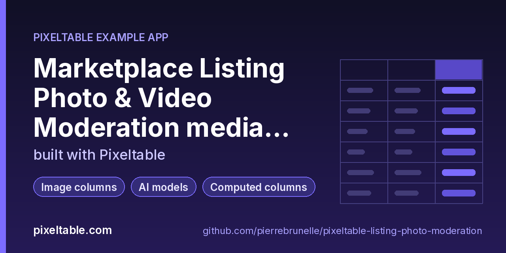

<!-- pixeltable-example-app: 20261023-listing-photo-moderation -->
# Moderate images and video with vision models in Python

**Short answer:** store each listing (title, description, photo) in a Pixeltable table and make every check a computed column. `openai.moderations` scores the text, `openai.chat_completions` (`gpt-4o-mini`, strict JSON schema) returns an allow/review/block verdict, policy flags and relative boxes for people, animals, vehicles and contact-info overlays, and `pixeltable.functions.vision` clips, converts and draws those boxes and scores them against human labels (`eval_detections` + `mean_ap`). Listing videos become a `frame_iterator` view (one frame every 2 s, each checked by the model) and an `audio_splitter` view over the extracted voice-over (transcribed, scanned for phone numbers and payment requests). A `decide` UDF combines it all into the review queue. No Hive/Rekognition glue, no job queue, no separate review database.

**Replaces:** Hive/Rekognition calls + a queue + a review DB

**Use case:** [pixeltable.com/use-cases/media-processing](https://pixeltable.com/use-cases/media-processing)



[](https://codespaces.new/pierrebrunelle/pixeltable-listing-photo-moderation?quickstart=1)
[](https://pixeltable.com)
[](https://pypi.org/project/pixeltable/)
[](https://github.com/pixeltable/pixeltable)
[](LICENSE)

`Listings` holds one row per listing: `listing_id`, seller, title, description, category, price, the photo (`pxt.Image`) and optional human ground truth (`gt`: labels + relative xywh boxes). Computed columns read the photo metadata, make a 512 px thumbnail, run `omni-moderation-latest` over the text, regex-scan it for phone numbers and off-platform words, and ask `gpt-4o-mini` for a strict-JSON verdict on the photo. `bboxes_clip_to_canvas` cleans the model's boxes, `to_pixels` turns them into pixel `xyxy`, `bboxes_convert` turns the human `xywh` boxes into `xyxy`, `eval_detections` scores each row and `bboxes_draw` saves an annotated copy. `decide` blocks hard violations and off-platform contact and sends people, live animals and wrong items to review. `ListingVideos` extracts the audio track (`video.extract_audio`); the `VideoFrames` view samples a frame every 2 s and checks it, the `VoiceClips` view splits the voice-over into ~6 s chunks, transcribes them (`gpt-4o-mini-transcribe`), moderates and scans them. `worst_decision` is a UDA that rolls frame verdicts up per video.

[Pixeltable](https://pixeltable.com) is open-source, Python-native **multimodal AI data infrastructure**: tables, incremental computed columns, UDFs, indexes and serving in one library, running locally or on Pixeltable Cloud.

> ⭐ **Like this example?** Star [pixeltable/pixeltable](https://github.com/pixeltable/pixeltable) on GitHub. It helps other developers find it.

## What this example shows

- **Incremental computed columns** powered by plain Python UDFs (`@pxt.udf`)
- **B-tree indexes** declared on the model (`__indexes__`) back the lookup queries
- **Multimodal media columns** with configurable media destinations
- **Vision functions** from `pixeltable.functions.vision`
- **AI provider functions** as computed columns
- **Iterators**: one input row fans out into many (frames, chunks, sentences) via a view
- **Image functions** from `pixeltable.functions.image`
- **Importable UDF module**: UDFs live in `udfs.py`; tables and queries live in `app.py` (Pixeltable resolves UDFs by module path)
- **`pixeltable.toml`** declares a local database and a **Pixeltable Cloud** database, so the same code deploys with `pxt db update`

## Pipeline

| Column | Built with | What it holds |
|---|---|---|
| `photo_meta`, `small` | `image.get_metadata`, `image.thumbnail` | size/mode, 512 px copy the model sees |
| `text_mod`, `text_flags` | `openai.moderations` (`omni-moderation-latest`) | moderation scores and the categories that fired |
| `text_contact` | `contact_info_in_text` UDF | phone numbers and off-platform words in title + description |
| `verdict` | `openai.chat_completions` (`gpt-4o-mini`, strict JSON schema) | allow/review/block, policy flags, category match, boxes |
| `pred_rel`, `pred_px` | `vision.bboxes_clip_to_canvas`, `to_pixels` | model boxes clipped to the image, in pixels |
| `gt_px` | `vision.bboxes_convert` (`xywh` -> `xyxy`), `to_pixels` | human boxes in pixels |
| `detections` | `vision.eval_detections` (IoU 0.5) | per-class TP/FP for the row; `mean_ap` aggregates |
| `annotated` | `vision.bboxes_draw` | the photo with the model's boxes and labels |
| `decision`, `status` | `decide` UDF | allow / review / block plus reasons; B-tree index on `status` |

## Video

| Table / view | Built with | What it holds |
|---|---|---|
| `listing_videos` | `video.get_duration`, `video.extract_audio` | the upload and its mp3 soundtrack |
| `video_frames` | `frame_iterator(fps=0.5)` + `gpt-4o-mini` | one checked frame every 2 s |
| `voice_clips` | `audio_splitter(duration=6)` + `gpt-4o-mini-transcribe` + `omni-moderation-latest` | the voice-over, chunk by chunk, scanned for contact info |

## Results on the demo data

Local and on Pixeltable Cloud: 9 listings -> 3 allow, 4 review (person in photo, live animal x2, wrong item), 2 block (phone number printed on the photo, a threat in the description). The seller video that cuts to the phone-number photo is blocked from its last three frames, and the voice-over chunk "text me on WhatsApp at 555-0142 and pay with a gift card" is caught by the transcript scan. mAP@0.5 of `gpt-4o-mini` boxes vs human boxes: contact_info 1.0, person / animal / vehicle 0.0.

## Pixeltable Cloud

Add `system_dependencies = ['ffmpeg']` to the database entry in `pixeltable.toml` (audio extraction), set the key as a database secret (`pxt secret set pxt://<your-org>:<your-db> OPENAI_API_KEY=...`, then `pxt db restart`), run `pxt db update`, then `pxt schema update app.py pxt://<your-org>:<your-db>` and `python seed.py pxt://<your-org>:<your-db>`. The CLI takes `MARKET_CATALOG=pxt://<your-org>:<your-db>`. If you edit `udfs.py` after `pxt db update`, run it again before `pxt schema update` (the diff says so).

## Gotchas

- `distinct()` / `group_by()` on a JSON path now raises (pxt 0.7.20): store the value in a scalar column (here `status`) and group on that.
- A local `destination=` for generated media must be outside the project directory.

## Demo data

`data/photos/` holds COCO images from the Pixeltable repo plus one edited copy with a phone-number banner; `L-009` references its photo by URL. `data/ground_truth.json` has the human boxes (from the COCO labels, mapped to person / animal / vehicle, plus the banner). The two videos in `data/videos/` are stills with OpenAI text-to-speech voice-overs.

## What's inside

| File | What it is |
|------|------------|
| `.devcontainer/devcontainer.json` | GitHub Codespaces / Dev Container config: Python 3.12, installs `requirements.txt` |
| `.github/social-preview.png` | Social preview image (1280x640) |
| `CITATION.cff` | Citation metadata (authors, license, release date, keywords) |
| `app.py` | Tables declared as Python classes and `@pxt.query` functions |
| `cli.py` | Command-line front end for the moderation queue |
| `data/ground_truth.json` | Sample data |
| `data/overlay_box.json` | Sample data |
| `data/photos/coco-000000000009.jpg` | Sample data |
| `data/photos/coco-000000000030.jpg` | Sample data |
| `data/photos/coco-000000000036.jpg` | Sample data |
| `data/photos/coco-000000000042.jpg` | Sample data |
| `data/photos/coco-000000000064.jpg` | Sample data |
| `data/photos/sewing-threads.jpg` | Sample data |
| `data/photos/vase-with-phone-banner.jpg` | Sample data |
| `data/videos/listing-threads.mp4` | Sample data |
| `data/videos/listing-vase.mp4` | Sample data |
| `pixeltable.toml` | Project config: the local database plus a Pixeltable Cloud database (sizing, deploy excludes) |
| `seed.py` | Load nine demo listings (photos) and two listing videos with seller voice-overs |
| `udfs.py` | Pixeltable UDFs (`@pxt.udf`) in their own importable module, imported by `app.py` |
| `requirements.txt` / `pyproject.toml` | Dependencies (`pixeltable>=0.7.20`) |

**Tables**

| Table | Stored columns | Computed columns |
|-------|---------|------------------|
| `listings` | `listing_id`, `seller`, `title`, `description`, `category`, `price`, `photo`, `gt` | `photo_meta`, `small`, `text`, `text_mod`, `text_flags`, `text_contact`, `vision_raw`, `verdict`, `pred_labels`, `pred_scores`, `pred_rel`, `pred_px`, `gt_px`, `detections`, `annotated`, `decision`, `status` |
| `listing_videos` | `listing_id`, `seller`, `video` | `duration`, `audio` |
| `video_frames` | - | `t`, `small`, `check_raw`, `check`, `frame_decision` |
| `voice_clips` | - | `heard`, `said`, `contact`, `said_mod` |

## Run in your browser (GitHub Codespaces)

[](https://codespaces.new/pierrebrunelle/pixeltable-listing-photo-moderation?quickstart=1)

1. Click **Open in GitHub Codespaces** above (or [this link](https://codespaces.new/pierrebrunelle/pixeltable-listing-photo-moderation?quickstart=1)). The dev container installs Python 3.12 and `pixeltable>=0.7.20` from `requirements.txt`.
2. In the codespace terminal, create the tables, seed them and run the app:

   ```bash
   pxt schema update app.py marketplace
   export OPENAI_API_KEY=...   # ~45 calls for the demo data: moderation + gpt-4o-mini vision + transcription
   pxt schema update app.py marketplace
   python seed.py              # 9 listings (one photo by URL) + 2 listing videos with voice-overs
   python cli.py queue         # what a moderator has to look at, with reasons
   python cli.py annotate L-003 out.jpg   # the photo with the model's boxes drawn on it
   python cli.py quality       # mAP@0.5 of the model's boxes vs the human boxes
   python cli.py videos && python cli.py spoken
   ```


## Quickstart

Requires Python 3.11+ and `pixeltable>=0.7.20`.

```bash
git clone https://github.com/pierrebrunelle/pixeltable-listing-photo-moderation.git
cd pixeltable-listing-photo-moderation
python -m venv .venv && source .venv/bin/activate
pip install -r requirements.txt

# Create the tables in a local catalog directory named `marketplace`
pxt schema update app.py marketplace

export OPENAI_API_KEY=...   # ~45 calls for the demo data: moderation + gpt-4o-mini vision + transcription
pxt schema update app.py marketplace
python seed.py              # 9 listings (one photo by URL) + 2 listing videos with voice-overs
python cli.py queue         # what a moderator has to look at, with reasons
python cli.py annotate L-003 out.jpg   # the photo with the model's boxes drawn on it
python cli.py quality       # mAP@0.5 of the model's boxes vs the human boxes
python cli.py videos && python cli.py spoken
```

## Deploy to Pixeltable Cloud

The same `app.py` runs on [Pixeltable Cloud](https://pixeltable.com). Sign in (or get a free trial database with `pxt new`), point the second database entry in `pixeltable.toml` at your own database, then deploy:

```bash
pxt login                       # or: export PIXELTABLE_API_KEY=<your-api-key>
# edit pixeltable.toml: name = 'pxt://<your-org>:<your-db>'
pxt db update pxt://<your-org>:<your-db>                 # build the image and upload the project
pxt schema update app.py pxt://<your-org>:<your-db>       # create the tables at the database root (no per-app folder)
```

Keep keys in environment variables or `pxt secret set`, never in code.

## Code walkthrough

**1. Business logic is plain Python, in `udfs.py`.** A `@pxt.udf` function can be used as a column expression. Pixeltable records UDFs by module path (`udfs.parse_verdict`), so they live in their own importable module rather than inline in the app: the daemon, serving workers and Pixeltable Cloud import it again by that path.

```python
# udfs.py
@pxt.udf
def parse_verdict(raw: str) -> pxt.Json:
    """Parse the vision model's JSON answer; tolerate a fenced code block."""
    raw = raw.strip()
    if raw.startswith('```'):
        raw = raw.strip('`').removeprefix('json').strip()
    return json.loads(raw)
```

**2. Tables are Python classes (`app.py`).** Annotated attributes are stored columns; attributes assigned an expression are **computed columns** (`photo_meta`, `small`, `text`, `text_mod`, `text_flags`, `text_contact`, `vision_raw`, `verdict`, `pred_labels`, `pred_scores`, `pred_rel`, `pred_px`, `gt_px`, `detections`, `annotated`, `decision`, `status`), evaluated incrementally on every insert or update and recomputed when their inputs change. Indexes live next to the columns.

```python
# app.py
class Listings(TableModel, name='listings'):
    """One marketplace listing: text fields plus one photo, with optional human-drawn boxes."""

    listing_id = pxt.Column(type=pxt.String, primary_key=True)
    seller: pxt.String
    title: pxt.String
    description: pxt.String
    category: pxt.String
    price: pxt.Float
    photo: pxt.Image
    gt: pxt.Json | None  # {'labels': [int], 'boxes': [[x, y, w, h] relative]} from a human reviewer

    photo_meta = pxtf.image.get_metadata(photo)
    small = pxtf.image.thumbnail(photo, size=(512, 512))
    text = listing_text(title, description)
    text_mod = openai.moderations(text, model=MODERATION_MODEL)
    text_flags = flagged_categories(text_mod)
    text_contact = contact_info_in_text(text)
    vision_raw = openai.chat_completions(
        [
            {
                'role': 'user',
                'content': [
                    {'type': 'text', 'text': vision_prompt(title, category)},
                    {'type': 'image_url', 'image_url': small},
                ],
            }
        ],
        model=VISION_MODEL,
        model_kwargs={'response_format': VERDICT_SCHEMA, 'max_tokens': 500, 'temperature': 0},
    )
    verdict = parse_verdict(vision_raw.choices[0].message.content.astype(pxt.String))
    pred_labels = object_labels(verdict)
    pred_scores = object_scores(verdict)
    pred_rel = vision.bboxes_clip_to_canvas(object_boxes(verdict), format='xyxy')
    pred_px = to_pixels(pred_rel, photo.width, photo.height)
    gt_px = to_pixels(vision.bboxes_convert(gt.boxes, src_format='xywh', dst_format='xyxy'), photo.width, photo.height)
    detections = vision.eval_detections(
        pred_bboxes=pred_px, pred_labels=pred_labels, pred_scores=pred_scores,
        gt_bboxes=gt_px, gt_labels=gt.labels, min_iou=0.5,
    )
    annotated = vision.bboxes_draw(photo, pred_px, labels=label_names(pred_labels), width=3)
    decision = decide(category, text_flags, verdict, text_contact)
    status = decision.decision.astype(pxt.String)

    __indexes__ = [pxt.BtreeIndex(status), pxt.BtreeIndex(seller)]
```

**3. Queries are functions (`app.py`).** `@pxt.query` wraps a Pixeltable query so it can be called from Python or exposed as a route:

```python
# app.py
@pxt.query
def review_queue():
    """Listings a human must look at (review or block), newest reasons first."""
    return (
        Listings.where(Listings.status != 'allow')
        .order_by(Listings.listing_id)
        .select(Listings.listing_id, Listings.seller, Listings.title, Listings.status, Listings.decision.reasons)
    )
```

## FAQ

**How do I moderate images with a vision model in Python?**

Put the images in a Pixeltable table and add a computed column that calls `openai.chat_completions` with the image in an `image_url` content block and a strict JSON schema as `response_format`. Every insert runs the check; parse the answer with a UDF and branch on it in another computed column. In this app that is `Listings.verdict` and `Listings.decision`.

**How do I moderate a video, not just a photo?**

Create a view with `frame_iterator(video, fps=0.5)` and put the vision check on the view: one row per sampled frame. For the soundtrack, add `video.extract_audio(video)` to the base table and a second view with `audio_splitter`, then `openai.transcriptions` and `openai.moderations` on each chunk. A UDA (`worst_decision`) rolls frame verdicts up per video.

**How good are the model's bounding boxes?**

Store human boxes next to the photo and compare: `vision.eval_detections` per row and `vision.mean_ap` across rows. With `gpt-4o-mini` on the demo set, the contact-info banner box matched at IoU 0.5 (AP 1.0) while people, animals and vehicles did not (AP 0.0): use the boxes for highlighting and routing, not as a detector. Swap in a detection model for real boxes.

**Does it catch sellers moving buyers off the platform?**

Three ways: a regex UDF on the title and description, a `contact_info` box and `off_platform_contact` flag from the vision model when a phone number is printed on the photo, and the transcript of the video voice-over (the demo seller says a WhatsApp number and asks for a gift card).

**Can I change the policy without re-running the models?**

Yes. The model answers are stored columns; the policy is the `decide` UDF. Edit it and run `pxt recompute marketplace/listings decision -f`: only `decision` and its dependants are recomputed, with no new model calls. Note that `pxt schema diff` does not notice UDF body edits, so the recompute is on you.

## Learn more

- 🌐 Website: https://pixeltable.com
- 📚 Docs: https://docs.pixeltable.com
- 💻 Source: https://github.com/pixeltable/pixeltable (⭐ star it if Pixeltable is useful to you)
- 📦 PyPI: https://pypi.org/project/pixeltable/
- 🎯 Use case: https://pixeltable.com/use-cases/media-processing
- 🧩 More example apps: https://pierrebrunelle.github.io/awesome-pixeltable-apps/

**[More Pixeltable example apps →](https://pierrebrunelle.github.io/awesome-pixeltable-apps/)**

---

<sub>Built as part of a daily series of Pixeltable example apps · Pixeltable 0.7.20 · Python, incremental computed columns · Licensed under Apache-2.0.</sub>
